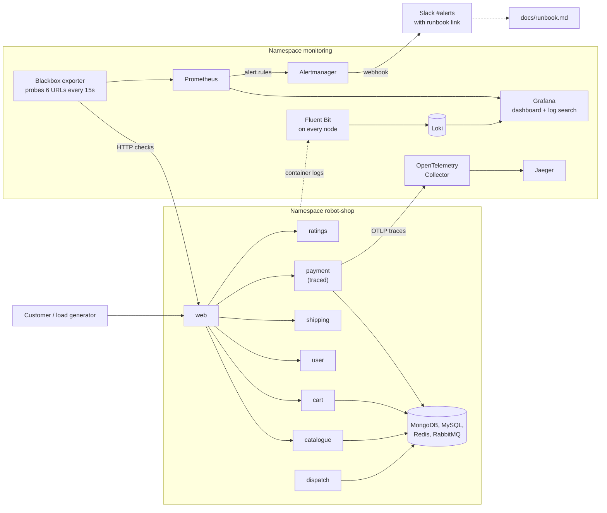

# Keep It Running: observability for Stan's Robot Shop (Capstone 2)

This repository is a fork of [instana/robot-shop](https://github.com/instana/robot-shop), a demo online store made of about a dozen small services.
Capstone 1 was about **shipping** an application. This capstone is about **keeping it running**: knowing when it is unhealthy, finding out why, and having a plan for what to do about it.

What was added on top of the original shop:

| Question an operator asks | Answer built here |
|---|---|
| Is the shop healthy right now? | A **Grafana dashboard** for requests, errors and latency |
| What did the services say before it broke? | **Fluent Bit and Loki**: searchable logs by service |
| Where in the request path is it slow or failing? | **OpenTelemetry and Jaeger**: one traced request |
| How reliable do we promise to be? | An **SLO** (99% availability) with an **error budget policy** |
| Who finds out when it breaks, and what do they do? | A **Slack alert** that links to a **runbook** |
| What happens in a real incident? | An **incident drill** and a **blameless postmortem** (see section 9) |

> Author: _your name_ &nbsp;|&nbsp; Cloud: AWS `eu-north-1` (Stockholm) &nbsp;|&nbsp; Cluster: the EKS cluster from Capstone 1

---

## 1. Architecture



**How to read it:** customers (here, a load generator) talk to `web`, which calls the other services. The `monitoring` namespace watches the shop from the outside and the inside. Three kinds of signal are collected: **metrics** (numbers over time, in Prometheus), **logs** (text lines, in Loki) and **traces** (one request's journey, in Jaeger). Alertmanager turns a metric problem into a Slack message.

## 2. Repository layout

| Path | What it is |
|---|---|
| `K8s/helm/` | The upstream Helm chart that installs Robot Shop. One local change: Redis uses temporary storage (see section 4). |
| `K8s/load-deployment.yaml` | The load generator ("load-gen"): 15 simulated shoppers, including a deliberate trickle of failing requests |
| `observability/blackbox.yaml` | Blackbox exporter and the list of six URLs to probe |
| `observability/dashboard.yaml` and `dashboard.json` | The Grafana dashboard as code (the YAML loads it, the JSON is the same dashboard) |
| `observability/loki.yaml` and `loki-datasource.yaml` | Log storage and its connection to Grafana |
| `observability/fluent-bit.yaml` | The log collector and its configuration |
| `observability/tracing.yaml` | Jaeger and the OpenTelemetry Collector |
| `observability/payment-otel-patch.yaml` | Adds tracing to the `payment` service without rebuilding its image |
| `observability/slo-rules.yaml` | The alert rules for the SLO |
| `observability/alertmanager-values.yaml` | Sends the SLO alerts to Slack |
| `docs/slo.md` | The SLO and the error budget policy |
| `docs/runbook.md` | What to do when the alert fires |
| `docs/postmortem.md` | The blameless postmortem for the incident drill |
| `README-upstream.md` | The original Robot Shop README |

## 3. Where it runs

The same Amazon EKS cluster from Capstone 1 (Terraform in the `voting-app` repository), rebuilt with two nodes instead of one, because the shop plus the monitoring tools need more memory than one 8 GiB node offers:

```bash
cd ~/voting-app/terraform
terraform plan -var node_count=2 -out=tfplan
terraform apply tfplan
aws eks update-kubeconfig --region eu-north-1 --name voting-capstone
```

## 4. Step 1: deploy the shop and watch it

```bash
helm install robot-shop ~/robot-shop/K8s/helm --namespace robot-shop --create-namespace --set nodeport=true --wait --timeout 10m
kubectl apply -n robot-shop -f ~/robot-shop/K8s/load-deployment.yaml
kubectl get pods -n robot-shop
```

Decisions worth knowing:

- **`nodeport=true`** stops the chart from creating a public AWS load balancer (extra cost). The shop is viewed with `kubectl port-forward -n robot-shop svc/web 8081:8080` and then `http://localhost:8081`.
- **Redis storage.** The chart asks for a disk of class `standard`, which does not exist on this cluster (there is no persistent-disk driver installed). The file `K8s/helm/templates/redis-statefulset.yaml` was edited so Redis uses temporary storage. Redis only holds shopping carts, so nothing important is lost on a restart.
- **Instana** (the vendor's monitoring product) is not used. The chart's `eum.key` stays `null`, as the capstone requires.
- **Load generator.** It runs 15 simulated shoppers all the time, so graphs, logs and traces always have data. One of its tasks sends an empty cart to the payment service on purpose, which returns HTTP 500. That is a steady supply of real errors to practise on.

**Done when:** every pod is `Running` and the shop opens in a browser. (Screenshot: `docs/screenshots/01-shop-and-pods.png`.)

## 5. Step 2: metrics and the dashboard

```bash
helm install monitoring oci://ghcr.io/prometheus-community/charts/kube-prometheus-stack --namespace monitoring --create-namespace \
  --set kubeEtcd.enabled=false --set kubeControllerManager.enabled=false --set kubeScheduler.enabled=false --set kubeProxy.enabled=false \
  --set prometheus.prometheusSpec.retention=24h \
  --set prometheus.prometheusSpec.serviceMonitorSelectorNilUsesHelmValues=false \
  --set prometheus.prometheusSpec.podMonitorSelectorNilUsesHelmValues=false \
  --set prometheus.prometheusSpec.probeSelectorNilUsesHelmValues=false --wait --timeout 10m
kubectl apply -f observability/blackbox.yaml
kubectl apply -f observability/dashboard.yaml
```

- **kube-prometheus-stack** installs Prometheus (collects numbers), Grafana (draws graphs) and Alertmanager (sends alerts). The four `.enabled=false` flags switch off checks for parts of Kubernetes that AWS manages and keeps private, which would otherwise raise permanent false alarms.
- **Why probes?** Robot Shop's own services only publish business counters (items sold, cart value). They do not publish request rate, errors or latency. So requests, errors and latency are measured from the outside by the **blackbox exporter**, which requests six real URLs through the shop's front door every 15 seconds: the home page, `/api/catalogue/categories`, `/api/catalogue/products`, and the health pages of cart, user and payment. This is the same view a customer has, and it becomes the availability measurement for the SLO.
- **The dashboard** "Robot Shop: requests, errors, latency" has seven panels: availability, error rate, p95 latency (three big numbers), then requests per minute, errors, latency and HTTP status code per URL. It is stored as a ConfigMap with the label `grafana_dashboard: "1"`, which Grafana loads automatically, so it is rebuilt from code and not drawn by hand. The same dashboard is in `observability/dashboard.json`.
- The chart is pulled from `ghcr.io` (OCI) because the usual chart website (GitHub Pages) was not reachable from the author's network.
- Metrics are kept for 24 hours in temporary storage, so a Prometheus restart loses history. That is why the dashboard itself is exported as code.

**Done when:** the dashboard shows availability near 100%, six URLs in each graph. (Screenshot: `docs/screenshots/02-dashboard.png`.)

## 6. Step 3: logs

```bash
kubectl apply -f observability/loki.yaml
kubectl apply -f observability/loki-datasource.yaml
kubectl apply -f observability/fluent-bit.yaml
```

- **Fluent Bit** runs on every node, reads each container's log file, looks up which pod it came from, and forwards the lines to **Loki**, which stores them. Grafana searches them.
- Each log line carries four labels: `job`, `namespace`, `container` and `service` (the `service` label comes from Robot Shop's own pod labels, for example `service=cart`).
- **Searching in Grafana** (Explore, data source Loki):

  | Goal | Query |
  |---|---|
  | All logs of one service | `{service="cart"}` |
  | Errors in one service | `{service="payment"} \|~ "(?i)error\|fail"` |
  | Errors anywhere in the shop | `{namespace="robot-shop"} \|~ "(?i)error"` |

- **A note on "error level".** Robot Shop writes plain-text logs without a `level` field, so levels are found by searching the text for words like "error" (case-insensitive). A structured logger would allow a real `level` label.
- Lesson learned: an early version turned every pod label into a Loki label, and Loki rejected streams with more than 15 labels. The configuration now keeps only the four labels above.

**Done when:** `{service="cart"}` returns log lines and the payment error search returns failures. (Screenshots: `docs/screenshots/03-logs-*.png`.)

## 7. Step 4: tracing

```bash
kubectl apply -f observability/tracing.yaml
kubectl patch deployment payment -n robot-shop --patch-file observability/payment-otel-patch.yaml
```

- A **trace** follows one request through the system. **OpenTelemetry** is the standard way to produce traces; the **Collector** receives them and forwards them to **Jaeger**, which stores and displays them.
- **One service is traced: `payment`.** It sits on every checkout and calls other services, so one trace shows a real request. The other Robot Shop services run Node 14, which is too old for current OpenTelemetry libraries.
- **No image rebuild.** The patch adds an init container that installs pinned OpenTelemetry packages (version 0.48b0 and 1.27.0, chosen because they support Python 3.9) into a shared folder, then starts the service through the `opentelemetry-instrument` wrapper. The payment container's memory limit was raised from 100 MiB to 300 MiB because the wrapper needs more.
- If you run `helm upgrade` on Robot Shop later, it replaces the payment deployment and the tracing patch must be applied again.
- Undo: `kubectl rollout undo deployment/payment -n robot-shop`.
- Viewing: `kubectl port-forward -n monitoring svc/jaeger 16686:16686`, open `http://localhost:16686`, choose service **payment**, **Find Traces**.

**Done when:** a `payment: POST /pay/<id>` trace appears in Jaeger. (Screenshots: `docs/screenshots/04-trace-*.png`.) Traces from the deliberately empty cart carry a red `error=true` marker.

## 8. Step 5: the SLO and the alert

```bash
kubectl create secret generic slack-webhook -n monitoring --from-literal=url="<your Slack webhook URL>"   # never commit this
kubectl apply -f observability/slo-rules.yaml
helm upgrade monitoring oci://ghcr.io/prometheus-community/charts/kube-prometheus-stack --version 92.11.0 --namespace monitoring --reuse-values -f observability/alertmanager-values.yaml --wait --timeout 10m
```

The full text is in [`docs/slo.md`](docs/slo.md). In short:

- **SLI:** the share of probe requests that succeed (HTTP 2xx).
- **SLO:** **99% over a rolling 30 days.**
- **Error budget:** the other 1%, which equals **432 minutes (7.2 hours)** of complete outage per 30 days. The policy says what we do as the budget shrinks: normal work above 50%, extra care from 50% to 25%, only reliability fixes below 25%, and a release freeze at 0%.
- **Alerts** (in `observability/slo-rules.yaml`):

  | Alert | Fires when |
  |---|---|
  | `RobotShopEndpointDown` | Any probed URL fails for 1 minute |
  | `RobotShopAvailabilityFastBurn` | More than 14.4% of requests fail over both the last 5 minutes and the last hour (the budget would be gone in about 2 days) |

- Each Slack message names the failing URL and links to [`docs/runbook.md`](docs/runbook.md), which lists what to do first (stop the damage), how to check recovery, where to look for the cause, and how to escalate.
- **No secret in Git.** The Slack webhook URL lives only in a Kubernetes secret, which Alertmanager reads from a mounted file. It appears in no file in this repository.

**Tested:** the cart service was scaled to zero on purpose. The alert reached Alertmanager, a Slack message arrived in `#alerts` with the runbook link, and a `RESOLVED` message followed when the cart was restored. (Screenshots: `docs/screenshots/05-slack-firing.png`, `05-slack-resolved.png`.)

During testing, the first Slack delivery failed with `unsupported protocol scheme ""` because the secret had been saved with an empty URL; recreating the secret fixed it. A good reminder to always test the alert path end to end.

## 9. Step 6: the incident drill

A script chose one service at random and scaled it to zero without saying which. The goal was to practise the real routine: notice, mitigate first, find the cause, write it up.

- **What broke:** `mongodb` (the database behind the catalogue and users), scaled to zero at 22:22 WAT on 24 October 2026.
- **How it was noticed:** `RobotShopEndpointDown` reached Slack about 1 to 2 minutes later for `catalogue/products`, `catalogue/categories` and `payment/health`.
- **Mitigation first:** `kubectl get deployments` showed `mongodb 0/0`, and `kubectl scale deployment/mongodb --replicas=1` restored it at 22:33. Total outage: **11 min 38 s**, about **1.3% of the monthly error budget**.
- **Findings:** the alerts named symptoms and not the cause, the runbook lacked a first diagnostic step (now added), and the fast-burn alert fired only after recovery because of its one-hour window.

The full timeline, root cause and action items are in [`docs/postmortem.md`](docs/postmortem.md). It is **blameless**: it describes what the system and the process allowed, not who is at fault. (Screenshots: `docs/screenshots/06-drill-*.png`.)

## 10. Rebuild order and access

Rebuild everything on a fresh cluster in this order: sections 3, 4, 5, 6, 7, 8. Access during a session (each command stays running in its own terminal tab):

```bash
kubectl port-forward -n robot-shop svc/web 8081:8080          # shop      http://localhost:8081
kubectl port-forward -n monitoring svc/monitoring-grafana 3300:80   # Grafana   http://localhost:3300
kubectl port-forward -n monitoring svc/jaeger 16686:16686      # Jaeger    http://localhost:16686
kubectl get secret -n monitoring monitoring-grafana -o jsonpath='{.data.admin-password}' | base64 -d; echo   # Grafana password, user "admin"
```

**Cost:** two nodes plus the EKS control plane cost roughly $0.40 per hour. Destroy the cluster when not working: `cd ~/voting-app/terraform && terraform plan -destroy -out=destroy.tfplan && terraform apply destroy.tfplan`.

## 11. Known limitations

- **Temporary storage everywhere** (Prometheus, Loki, Jaeger, Redis): a pod restart loses its data. A real setup would use persistent disks and the AWS EBS driver.
- **Synthetic measurement.** The availability figures come from six probe URLs, not from every real customer request, and they do not say which internal service is at fault; logs and traces do that.
- **Only `payment` is traced**, and traces stop at services that are not instrumented.
- **Logs have no structured level.** Error searches are text matches.
- **Demo-grade security.** Grafana uses its generated admin password, services are reached through `port-forward`, and the Collector and Jaeger have no authentication. Do not expose them publicly.
- The tracing patch is applied on top of the Helm release, so it is not part of the chart and must be re-applied after a chart upgrade.

## 12. Credits

Robot Shop: [instana/robot-shop](https://github.com/instana/robot-shop) (Apache 2.0). Observability stack: kube-prometheus-stack, Prometheus blackbox exporter, Grafana Loki, Fluent Bit, OpenTelemetry and Jaeger.
