# Evidence: Capstone 2, Keep It Running

Screenshots taken on 24 October 2026 while the system was running. Each section matches a step in the [README](../README.md).

## Step 1: Robot Shop deployed and healthy

The shop running on the Kubernetes cluster, viewed through `kubectl port-forward`.

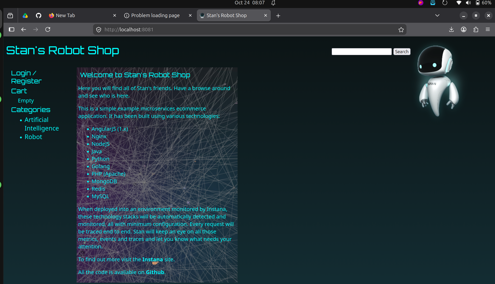
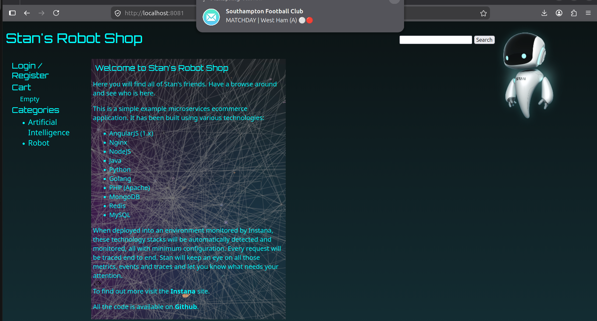

## Step 2: Metrics dashboard

The Grafana dashboard "Robot Shop: requests, errors, latency", built from blackbox probes of six shop URLs.

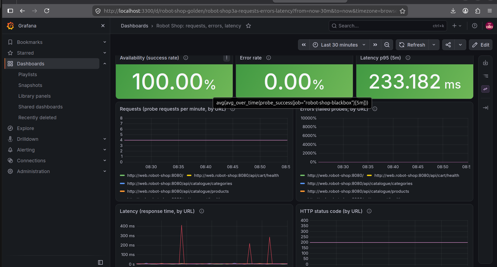
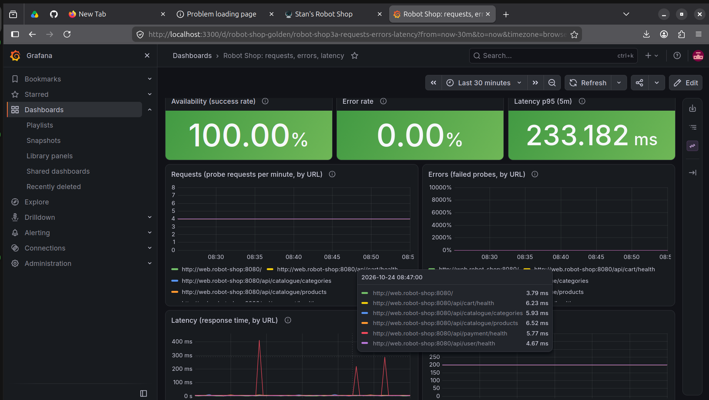

## Step 3: Logs searchable by service and error text

Fluent Bit sends container logs to Loki. These are searches in Grafana Explore, for example `{service="cart"}` and `{service="payment"} |~ "(?i)error|fail"`.

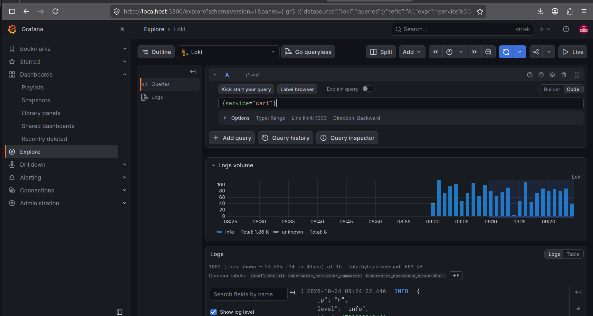
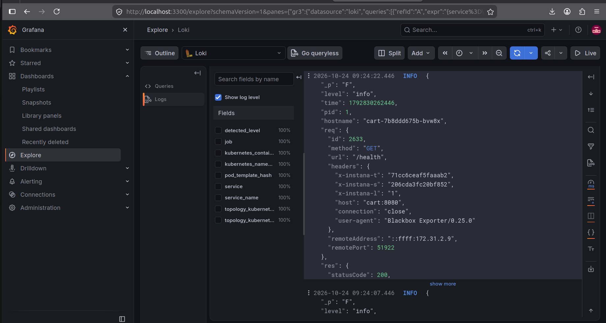

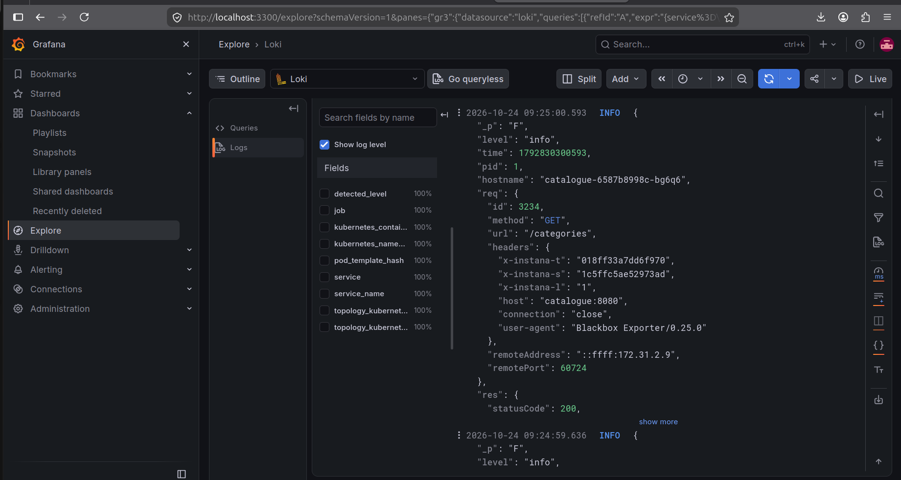
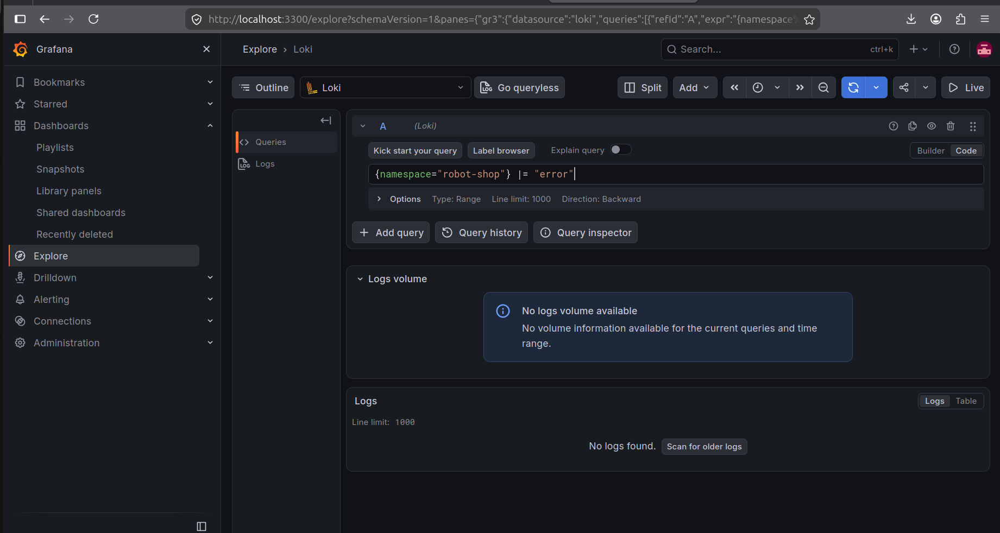
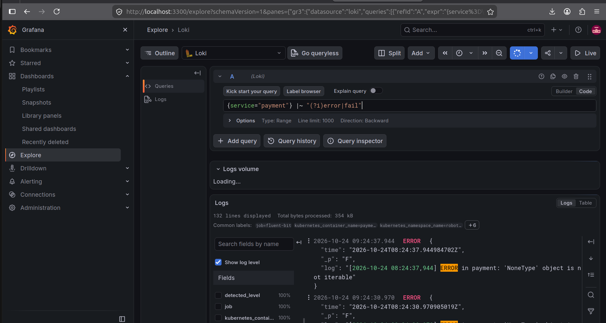
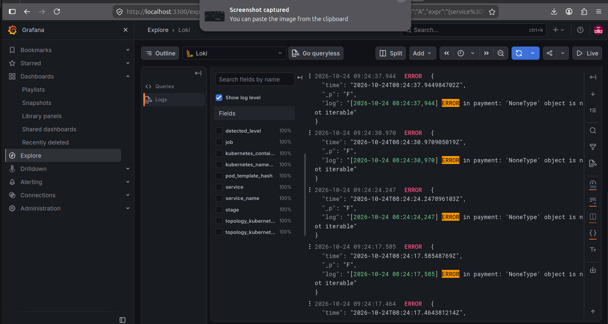

## Step 6: Incident drill, alerts in Slack

During the drill, MongoDB was scaled to zero. The alerts reached Slack within about two minutes, with a link to the runbook. See the [postmortem](postmortem.md) for the full timeline.

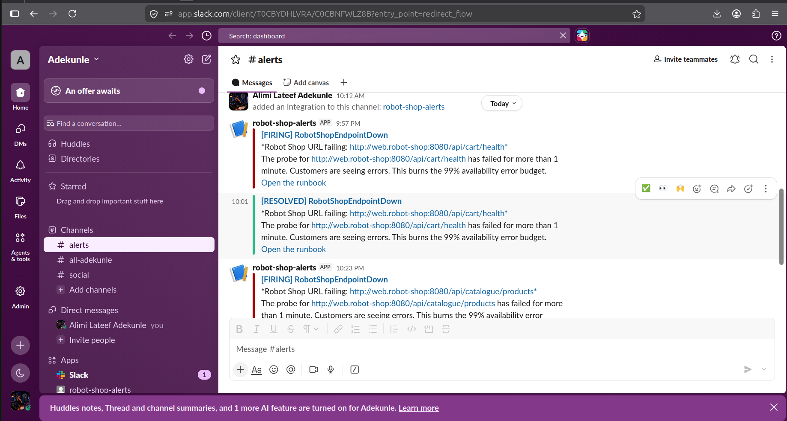
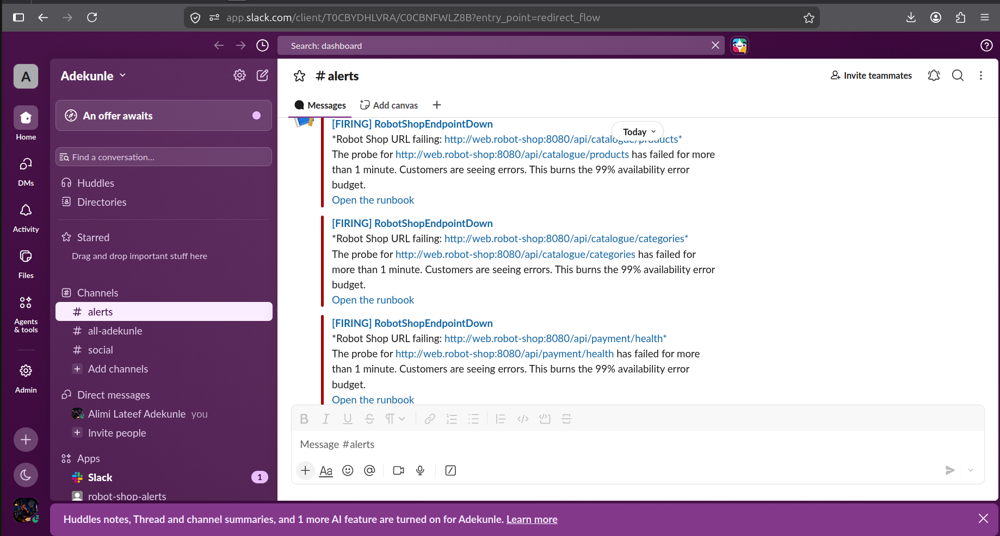
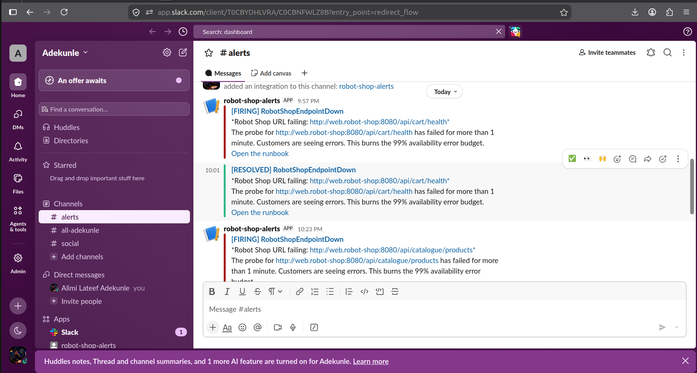
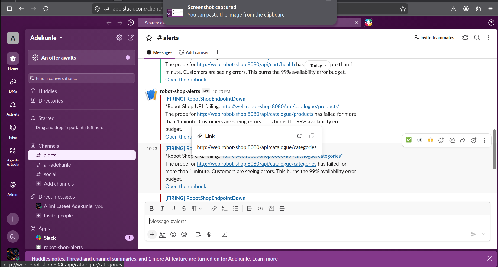
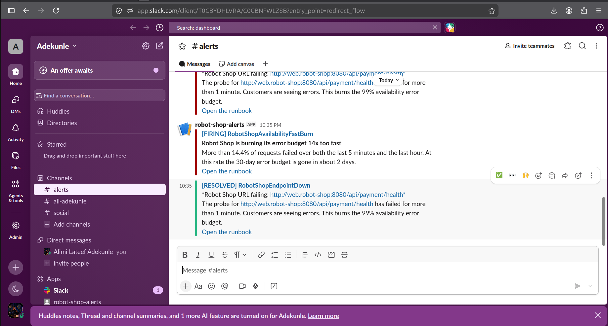

<!--
Add these when the screenshots exist, then delete this comment block:

## Step 4: Trace in Jaeger

## Step 6: Dashboard during the drill (Last 1 hour)

## Step 6: Logs during the drill

-->
